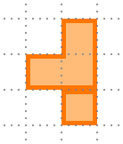
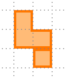
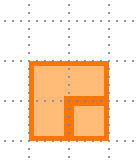

# 対称パズル (Symmetry Puzzle)

青い操作キャラでオレンジ色のブロックを押し、対称な図形を作るブラウザパズルです。

[ブラウザで遊ぶ](https://tatt61880.github.io/symmetry-puzzle/)

## クリア条件

オレンジ色のマスをすべて、辺と辺でつながったひとつの図形にします。その形が選んだパズルの条件を満たせばクリアです。各パズル名からレベル1を遊べます。

| [線対称](https://tatt61880.github.io/symmetry-puzzle/?mode=line&id=1) | [点対称](https://tatt61880.github.io/symmetry-puzzle/?mode=point&id=1) | [線点対称](https://tatt61880.github.io/symmetry-puzzle/?mode=special&id=1) |
| :---: | :---: | :---: |
|  |  |  |
| 直線で折ると重なる | 180度回すと重なる | 線対称と点対称の両方 |

## 操作

| 操作 | 画面のボタン | キーボード |
| --- | --- | --- |
| 上下左右に移動 | 方向ボタン | 矢印キー または `W` `A` `S` `D` |
| 対称軸操作（対応レベルのみ） | 方向ボタンの中央 | `Enter` |
| 1手戻す／戻した手を進める | 1手戻す／1手進める | `Z`／`Y` |
| 最初からやり直す | リトライ | `R` |

同じレベルでも、異なる形でクリアできることがあります。見つけた完成形は「形状」で確認できます。クリア手数と完成形はブラウザに自動保存され、タイトル画面の王冠ボタンから記録のバックアップと復元ができます。

## ローカルでの実行

リポジトリ直下で `python -m http.server 8000 --bind 127.0.0.1` を実行し、ブラウザで [127.0.0.1:8000 を開きます](http://127.0.0.1:8000/)。

テスト一式は、`npm ci` で依存パッケージをインストールしたあと、`make test` で実行できます。
